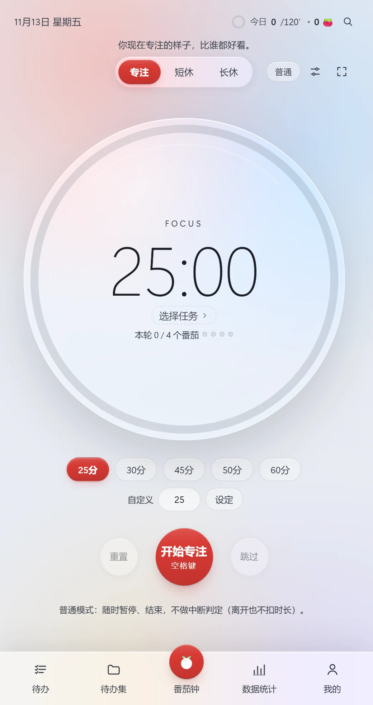

# Fanqie Alarm (番茄闹钟)

[中文说明](README.md) · **English**

<p>


</p>

A Pomodoro timer for Windows that is **one HTML file inside a thin WebView2 host**.
All UI and logic live in `index.html`; the C# shell only opens a window and points it at the file.
No framework, no build step, no network: data stays in `localStorage` on your machine.



## Why this one

- **Readable end to end.** The whole app is a single, commented HTML file — you can audit it in an afternoon.
- **Actually offline.** No fonts, icons or scripts are fetched; `performance.getEntriesByType("resource")` is empty.
- **Pomodoro with teeth.** Strict mode (no pausing) and "study" mode (fullscreen, leaving the window aborts the session).

## Features

- Three timing modes: countdown, count-up (completes at the target), and untimed (just accumulates)
- Away detection: switching windows, minimising or suspending the machine pauses the clock; coming back decides whether to credit the gap
- Midnight split: a 22:00 → 01:00 session is booked per day, not by its end timestamp
- In-flight snapshot: closing or crashing restores the session as paused, never credits offline time
- Single-writer: only one window may write the save file; others go read-only and can take over
- Tasks, task collections, give-up reasons, heatmap, focus-hours stats, white noise, desktop notifications
- CSV / JSON export (CSV escapes `= + - @` prefixes to stop formula injection)

## Build

Windows + the `csc` shipped with .NET Framework 4, plus the three WebView2 SDK binaries
(`Microsoft.Web.WebView2.Core.dll`, `Microsoft.Web.WebView2.WinForms.dll`, `WebView2Loader.dll`)
from the `Microsoft.Web.WebView2` NuGet package (`lib/net45` and `runtimes/win-x64/native`).
They are not committed.

```bash
bash native/build_glass.sh <output-dir>   # dev shell, no icon (in-place rebuild fails: script copies onto itself)
bash native/build_ship.sh                 # release exe with icon -> native/dist/番茄闹钟.exe
```

## Verification

```bash
python 验收/page_regress.py                                   # 12 page-level checks over CDP
ELECTRON_RUN_AS_NODE=1 "<path-to>\\Code.exe" 验收/timing_harness.js index.html after
                                                              # 41-row timing truth table, cut from the live file
```

Current state: `PAGE-REG ALL-OK` (12/12), truth table 41 rows / 0 red.

## Where data lives

`%LOCALAPPDATA%\FanqieAlarm\webview2` — never inside the program folder. Keys are prefixed `fanqie-alarm.*`.

## Known limits

- Unsigned: SmartScreen will ask for "More info → Run anyway" on first launch.
- 64-bit Windows 10/11 only (`WebView2Loader.dll` is x64); 32-bit untested.
- "Study" mode can't lock other programs — it can only go fullscreen and abort when you switch away.
- No sync, no accounts, no mobile client. Those are deliberate omissions.

## License

See `LICENSE.txt`: free to use and to copy the whole folder to family and friends; no rebranding as your own work,
no commercial resale. Third-party components (Microsoft Edge WebView2) are covered in `THIRD_PARTY_NOTICES.txt`.

## Feedback

Open an [issue](../../issues) with your Windows version, the steps, and which part broke
(won't start / timing wrong / data lost). If it failed to start, paste the dialog text — it names the cause.
