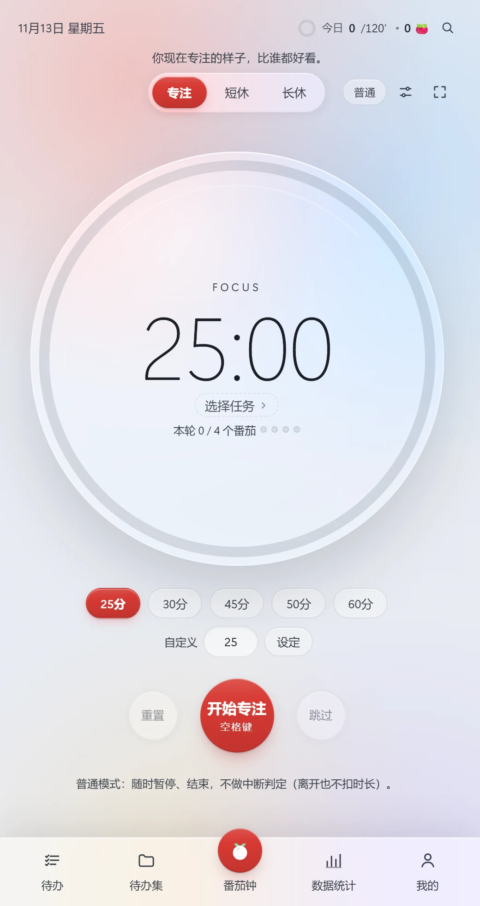

# 番茄闹钟（Fanqie Alarm）

**中文** · [English](README.en.md)

<p>


</p>

一个**单文件、纯本机**的番茄钟：界面和逻辑全在一个 `index.html` 里，外面套一层
WebView2 宿主（C# WinForms）。数据只存在本机 `localStorage`，页面不加载任何远程资源，
运行时不发一个网络请求。

*A single-file, offline Pomodoro timer for Windows: one HTML page inside a thin WebView2 host.*



> 学校/自习场景向：严格模式、学霸模式、正向计时、待办集、放弃理由、热力图、高效时段、
> 白噪音与系统通知。不是又一个网页版番茄钟套壳。

## 适合谁

- 想要一个**不联网、不注册、数据不出本机**的计时器，装完双击就能用。
- 需要"严格/学霸"这类**逼自己别切走**的强度，而不是只有倒计时。
- 愿意读代码：全部逻辑在一个 HTML 里，没有构建步骤、没有框架。

不适合：需要跨设备同步、多人自习室、手机端的人（本机版刻意不做这些）。


## 特性

- **三种计时方式**：倒计时、正向计时（`up`，到预设时长即完成）、不计时（`none`，只管累计）
- **三种强度**：普通 / 严格（禁用暂停）/ 学霸（全屏 + 切走即中断）
- **离开自动停表**：切窗口、最小化、整机休眠都走同一本账；回来按阈值决定"还不还那几秒"
- **跨零点分账**：22:00 开始跑 3 小时，昨天 / 今天各记多少当场算清，不靠结束时刻归属
- **进行中快照**：关窗、刷新、崩溃都能恢复，且恢复成"已暂停"，不补计离线时间
- **多窗口互斥**：同一份存档只许一个窗口写，后开的窗口转只读，可手动接管
- 待办 / 待办集 / 放弃理由 / 统计热力图 / 高效时段 / 白噪音 / 桌面通知
- 导出 CSV（对 `= + - @` 前缀做转义）与 JSON 备份

## 目录

```
index.html                  全部界面与逻辑（单文件，无外链）
native/FqHost.cs            WebView2 宿主（DWM 材质、单实例、失败提示）
native/build_glass.sh       开发壳编译（无图标）
native/build_ship.sh        交付件编译（带 app.ico）
native/dist/                编译产物（不入库）
验收/                       页面回归、计时真值表、探针与留底
原生玻璃版-说明.md           玻璃材质那一轮的设计与实测记录
LICENSE.txt                 许可声明
THIRD_PARTY_NOTICES.txt     第三方组件（WebView2）说明
```

## 构建

需要 Windows + .NET Framework 4 的 `csc`（系统自带）和 WebView2 SDK 的三个 DLL。
仓库不收录微软的二进制，按下面取一次放进 `native/`：

```
Microsoft.Web.WebView2.Core.dll       # NuGet: Microsoft.Web.WebView2 -> lib/net45
Microsoft.Web.WebView2.WinForms.dll   # 同上
WebView2Loader.dll                    # 同上 -> runtimes/win-x64/native
```

然后：

```bash
bash native/build_glass.sh <输出目录>   # 开发壳；就地重编会因 cp 同文件 + set -e 失败，必须给别的目录
bash native/build_ship.sh              # 交付件 -> native/dist/番茄闹钟.exe（带图标）
```

## 验收

```bash
# 12 项页面功能回归（起一个 WebView2 窗口，走 CDP）
python 验收/page_regress.py

# 41 行计时真值表（从 index.html 现盘切真代码跑，锚点缺失直接 rc=3）
# 需要一个 Electron 二进制当 Node 用：VS Code / Qoder / Electron 发行包里的 exe 都行
ELECTRON_RUN_AS_NODE=1 "<path-to>\Code.exe" 验收/timing_harness.js index.html after
```

两条门禁都不碰真机数据：`page_regress.py` 起的是独立窗口、临时 profile；真值表的时钟是注入的假时钟。

当前状态：`PAGE-REG ALL-OK`（12/12）、`真值表 41 行，红 0 行`。

## 数据在哪

```
%LOCALAPPDATA%\FanqieAlarm\webview2
```

不写进程序目录，换机时连同这个目录一起备份。键名前缀是 `fanqie-alarm.*`。

## 已知限制

- **未签名**：SmartScreen 首次会提示"更多信息 → 仍要运行"。没有购买代码签名证书。
- 只支持 64 位 Windows 10/11（`WebView2Loader.dll` 是 x64）；32 位未验证。
- 学霸模式锁不住其它程序，只能全屏 + 切走即中断（桌面平台的固有边界）。
- 自习室这类联网功能在本机版里没有。

## 许可

见 `LICENSE.txt`：可免费用、可整体拷贝给家人朋友；不许改名后冒充原作者发布，不许商业售卖。
第三方组件（Microsoft Edge WebView2）见 `THIRD_PARTY_NOTICES.txt`。

## 反馈

用出问题或想要某个功能，直接开 [Issue](../../issues)；请带上 Windows 版本、复现步骤，
以及"是哪一步出的问题"（打不开 / 计时不对 / 数据丢了）。程序在启动失败时会弹窗写清原因，把那句话一起贴上即可。

---

## 同作者的其他项目

- [LuHui播放器](https://github.com/gedouluhui/luhui-player) —— mpv 内核 + 手绘 Fluent 外壳的本地视频播放器
- [LuHui音乐播放器](https://github.com/gedouluhui/luhui-music-player) —— WinUI 3 + WASAPI 独占的本地音乐播放器
- [pc-phone-proxy](https://github.com/gedouluhui/pc-phone-proxy) —— 电脑 + 安卓双端自动选线代理
